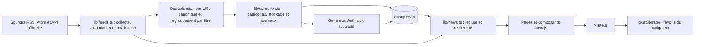

# NEXORA — documentation fonctionnelle et technique

Cette documentation décrit le fonctionnement réel de NEXORA : ce que les visiteurs peuvent faire, d’où viennent les articles, comment ils sont collectés et conservés, et quelles fonctions nécessitent une configuration supplémentaire.

- Guide de lancement et déploiement : [`README.md`](../README.md)
- Sources suivies dans le code : [`lib/sources.ts`](../lib/sources.ts)
- Schéma PostgreSQL : [`lib/db/schema.ts`](../lib/db/schema.ts)

## 1. Présentation fonctionnelle

NEXORA est un média de veille technologique qui rassemble des titres et des extraits courts provenant de sources identifiées. Chaque actualité conserve sa date de publication, son URL canonique, le nom de son éditeur et le flux qui l’a fait découvrir. Le texte intégral reste hébergé par l’éditeur.

L’interface ne prétend ni mesurer toute l’actualité technologique ni fabriquer de contenu lorsque les sources, la base de données ou le service d’IA ne sont pas disponibles. Elle affiche les articles collectés, leur provenance et des états vides explicites.

### Parcours et pages

| Adresse | Fonction |
| --- | --- |
| `/` | Met en avant l’article le plus récent, le fil, les catégories, les volumes observés, le briefing et le radar. |
| `/actualites` | Affiche les articles avec filtre par catégorie, tri chronologique et pagination de 12 articles par page. |
| `/categorie/[slug]` | Affiche les articles classés dans l’une des sept catégories. Une catégorie inconnue renvoie une page 404. |
| `/article/[slug]` | Présente le titre, la date, l’éditeur original, le flux de découverte, le résumé IA ou l’extrait disponible, un lien vers la publication originale et des articles associés. |
| `/recherche?q=...` | Recherche dans les titres, extraits, résumés et tags disponibles. La requête est limitée à 120 caractères. |
| `/tendances` | Compte les articles chargés par catégorie et affiche quelques articles récents. Ces volumes décrivent uniquement la collection NEXORA, pas la popularité générale d’un sujet. |
| `/briefing` | Affiche le dernier briefing effectivement généré et ses références, ou explique pourquoi aucun briefing n’est disponible. |
| `/radar` | Présente les articles réellement collectés dans les catégories développement, matériel et open source. Ce n’est pas un catalogue indépendant de produits. |
| `/favoris` | Affiche les articles marqués dans le navigateur courant. Les favoris ne sont ni synchronisés entre appareils ni enregistrés dans PostgreSQL. |
| `/sources` | Présente les éditeurs et flux suivis. |
| `/a-propos` | Explique le projet et ses principes éditoriaux. |
| 
| `/api/collect` | Déclenche une collecte protégée par secret. Réservée à l’exploitation, pas à la navigation publique. |

Le bouton marque-page ajoute ou retire un favori dans `localStorage`. La recherche et les filtres interrogent la collection chargée ; ils ne lancent pas une nouvelle recherche sur l’ensemble du Web.

### Catégories

Les sept catégories utilisées sont Intelligence artificielle, Développement, Cybersécurité, Cloud & DevOps, Hardware, Open source et Entreprises. Le classement initial repose sur des mots-clés associés au titre et à l’extrait. Une source RSS connue peut fournir une catégorie de repli si aucun mot-clé ne correspond. Pour Hacker News, un titre qui ne correspond à aucune catégorie est écarté.

Lorsque l’IA est activée, son analyse peut ensuite remplacer cette catégorie. Une classification reste une aide éditoriale et doit être interprétée dans son contexte.

## 2. Architecture applicative

NEXORA est une application Next.js App Router, écrite en TypeScript et rendue côté serveur. Les composants interactifs de navigateur sont limités notamment aux favoris et à la recherche.



### Principaux répertoires et fichiers

| Chemin | Responsabilité |
| --- | --- |
| `app/` | Pages App Router, métadonnées, sitemap, robots.txt et routes API. |
| `components/` | Cartes d’article, barre de navigation, formulaires, pagination et composants interactifs. |
| `lib/sources.ts` | Définition des flux suivis et de leurs métadonnées. |
| `lib/feeds.ts` | Requêtes externes, validation, normalisation, classification initiale, attribution, déduplication et regroupement. |
| `lib/collection.ts` | Enregistrement PostgreSQL, reprise des traitements IA en attente et journaux de collecte. |
| `lib/ai-provider.ts` | Sélection explicite du fournisseur (`none`, `gemini`, `anthropic`) et génération JSON structurée via le SDK correspondant. |
| `lib/ai.ts` | Analyse et validation Zod d’un article via le fournisseur sélectionné. |
| `lib/briefing.ts` | Génération, validation et enregistrement du briefing périodique via le même fournisseur. |
| `lib/news.ts` | Accès aux articles persistés ou collecte en direct sans base configurée. |
| `lib/db/` | Sélection du pilote PostgreSQL et définition Drizzle des tables et index. |
| `drizzle/` | Scripts SQL d’initialisation et de mise à niveau. |
| `tests/` | Tests unitaires de collecte, parsing, sécurité des URL et regroupement. |
| `scripts/verify-feeds.ts` | Vérification réseau manuelle des sources configurées. |
| `Dockerfile`, `compose.yaml` | Image de production locale et services Docker. |
| `vercel.json` | Programmation quotidienne du Cron Vercel. |

### Technologies

- Next.js App Router, React et TypeScript.
- PostgreSQL avec Drizzle ORM.
- Pilote Neon HTTP pour les URLs de base Neon ; pilote `postgres` pour PostgreSQL standard, dont Docker.
- Flux RSS et Atom analysés avec `rss-parser`, et API officielle Hacker News.
- Anthropic facultatif pour les résumés, classifications et briefings.
- Zod pour valider les données de l’API Hacker News et les réponses produites par l’IA.

## 3. Cycle de vie d’un article

1. **Déclenchement.** Une page sans base demande les articles aux flux. Avec PostgreSQL, les pages lisent les articles déjà conservés. Une collecte persistante est déclenchée explicitement par `/api/collect`, par la commande manuelle ou par le Cron Vercel.
2. **Téléchargement.** Les cinq sources configurées sont interrogées en parallèle. Les requêtes sont mises en cache par Next.js pendant dix minutes. Les flux RSS/Atom fournissent au plus 15 entrées chacun. Hacker News fournit au plus ses 15 premières histoires, chargées par lots de huit.
3. **Contrôles et normalisation.** NEXORA vérifie les réponses, les titres, les dates et les URL HTTP(S), supprime le balisage d’extrait, applique les filtres de pertinence et attribue une catégorie initiale. Un flux en échec est signalé indépendamment des autres ; une panne partielle n’efface pas les résultats des flux fonctionnels.
4. **Provenance.** Pour un flux d’éditeur, cet éditeur est la source. Pour une histoire Hacker News avec une URL externe, le domaine de l’éditeur externe est la source originale, et Hacker News est conservé séparément comme flux de découverte.
5. **Déduplication.** Au sein d’une collecte, les articles ayant la même URL canonique sont fusionnés. Si plusieurs variantes existent, l’extrait le plus long est conservé. En base, une contrainte d’unicité sur l’URL canonique empêche aussi les doublons d’une collecte à l’autre.
6. **Regroupement.** Les titres sont comparés à partir de leurs mots normalisés. Deux articles peuvent partager un groupe si au moins deux mots significatifs sont communs et que leur recouvrement atteint le seuil configuré de 65 %. Ce rapprochement textuel n’est pas une vérification factuelle.
7. **Persistance.** Les catégories et sources sont insérées si elles n’existent pas, puis les articles sont enregistrés. Une base rend la collection persistante ; sans base, l’application présente les flux disponibles sans historique durable.
8. **Enrichissement facultatif.** Si le fournisseur choisi et sa clé sont configurés, au plus trois articles sans résumé sont traités par collecte. Ils sont repris par ordre d’ancienneté lors des exécutions suivantes. Les résumés enregistrés ne sont pas régénérés ; les échecs sont consignés et n’empêchent pas d’afficher l’article ou sa source.
9. **Affichage.** Les pages lisent les articles, les ordonnent par date et montrent toujours la provenance et un lien vers la publication originale.

### Sources configurées

| Source / flux | Méthode | Limite par collecte |
| --- | --- | ---: |
| Hacker News | API Firebase officielle ; seules les histoires technologiques classables avec une URL d’article sont retenues. | 15 histoires examinées |
| OpenAI News | RSS officiel | 15 entrées examinées |
| GitHub Blog | RSS officiel | 15 entrées examinées |
| Google Security Blog | Atom officiel | 15 entrées examinées |
| Cloudflare Blog | RSS officiel | 15 entrées examinées |

La limite théorique avant les filtres est donc de 75 entrées examinées par collecte. Le nombre réellement retenu est souvent inférieur : certains posts ne sont pas des histoires, n’ont pas d’URL ou de date exploitable, sont hors sujet, ou échouent à la classification. Les flux et les filtres se modifient dans `lib/sources.ts` et `lib/feeds.ts`.

Les requêtes RSS ont un délai maximal de 12 secondes ; les requêtes unitaires Hacker News ont un délai maximal de 8 secondes. Les erreurs de sources sont consignées côté serveur et renvoyées dans le résultat de collecte. Le contenu est traité comme donnée externe non fiable. NEXORA ne récupère pas les pages complètes des articles.

## 4. Traitements IA

### Fournisseur et activation

`AI_PROVIDER` sélectionne un fournisseur ; sa valeur par défaut est `none`. Les valeurs autorisées sont `none`, `gemini` et `anthropic`. Une clé présente sans fournisseur explicitement sélectionné ne déclenche aucun appel. Une valeur invalide est signalée comme erreur de configuration.

- `AI_PROVIDER=gemini` requiert `GEMINI_API_KEY` et utilise le modèle fixe `gemini-2.5-flash-lite`. Le SDK applique un délai de 10 secondes et une seule tentative réseau, sans retries.
- `AI_PROVIDER=anthropic` requiert `ANTHROPIC_API_KEY` et utilise `ANTHROPIC_MODEL` ou, à défaut, `claude-haiku-5-5`.
- `AI_PROVIDER=none` désactive résumés et briefings IA. Il n’y a aucun basculement automatique entre fournisseurs.

Le modèle Gemini est fixé pour éviter de choisir accidentellement un modèle payant. Avant toute utilisation gratuite, vérifier dans AI Studio la disponibilité et les quotas gratuits effectivement applicables au projet. Ne pas activer sa facturation pour éviter qu’un changement de quota ou de modèle puisse occasionner des frais. Les quotas gratuits ne sont pas garantis et peuvent changer. Google indique que les contenus envoyés sur son palier gratuit peuvent être utilisés pour améliorer ses produits ; le pipeline n’envoie que le titre et l’extrait public du flux, pas le texte intégral.

### Analyse des articles

Avec un fournisseur et une clé correctement configurés, NEXORA demande en français :

- un résumé fidèle de deux ou trois phrases ;
- une catégorie parmi les sept catégories autorisées ;
- jusqu’à six tags ;
- jusqu’à huit entités explicitement présentes.

Le titre et un extrait éventuellement tronqué à 3 000 caractères sont transmis au modèle, pas le texte intégral de l’article. Pour Gemini, le SDK officiel transmet un schéma JSON contraint ; Anthropic reçoit le même format demandé dans l’instruction. La réponse doit être un objet JSON valide et satisfaire le schéma Zod avant d’être enregistrée. Les appels ont une limite de temps et les relances automatiques sont désactivées.

Le prompt indique que le contenu fourni est une donnée non fiable, que ses instructions doivent être ignorées et qu’aucun fait ne doit être inventé. Aucun outil n’est exposé au modèle. Ces contrôles réduisent les risques, mais ne remplacent pas une relecture éditoriale : un résumé automatique peut être incomplet ou incorrect.

Avec `AI_PROVIDER=none` ou sans la clé correspondant au fournisseur sélectionné, aucun résumé IA n’est fabriqué ; l’extrait du flux ou un message d’indisponibilité est utilisé. Les articles dont un résumé est déjà enregistré ne sont pas soumis de nouveau. Au plus trois articles sans résumé sont traités par collecte (`AI_ARTICLES_PER_COLLECTION`). Les réponses invalides, quotas atteints et erreurs API laissent l’article sans résumé et inscrivent une erreur dans les logs ; il pourra être repris lors d’une collecte ultérieure.

### Briefing

À la fin d’une collecte, l’application essaie de produire le briefing quotidien si moins de cinq sources ont signalé d’erreur. La génération exige PostgreSQL, un fournisseur sélectionné et sa clé.

Le modèle reçoit au plus les 20 articles les plus récents des dernières 24 heures et peut sélectionner jusqu’à huit éléments. Chaque élément doit référencer un identifiant fourni par l’application ; les références inconnues sont rejetées. Un seul briefing portant l’identifiant du jour est enregistré. La page `/briefing` affiche ce briefing et ses liens, ou précise qu’aucun briefing n’a encore été généré.

### Tendances et radar : limites importantes

La page `/tendances` calcule des volumes à partir des articles actuellement chargés et de leur catégorie. Elle n’utilise pas le modèle IA pour détecter une hausse temporelle. La table `trends` existe dans le schéma, mais la page ne s’appuie actuellement pas sur cette table.

Le radar est un filtre éditorial simple des articles de développement, matériel et open source. Il ne constitue pas une extraction IA autonome de projets ou d’outils.

## 5. Stockage et modèle de données

Les tables PostgreSQL principales sont :

| Table | Contenu |
| --- | --- |
| `categories` | Slug, nom et description des catégories. |
| `sources` | Éditeur/flux, URL du flux, site, catégorie par défaut, état activé et date de dernière collecte. |
| `articles` | Titre, résumé facultatif, extrait, URL canonique unique, provenance, date de publication, catégorie, tags, entités, groupe et dates de traitement. |
| `trends` | Schéma prévu pour conserver des sujets et des fenêtres de comptage ; la page Tendances actuelle calcule ses nombres à la lecture des articles. |
| `briefings` | Titre, contenu, références d’articles et période couverte. |
| `processing_logs` | Résultat, message, nombre d’articles, source et durée des opérations. |

Les index portent notamment sur les dates de publication, la catégorie et la date, la source et la date, les URL canoniques uniques et les slugs uniques. Les définitions sont dans `lib/db/schema.ts`; les migrations SQL initiales sont dans `drizzle/`.

### Modes de lecture

- **Avec `DATABASE_URL` :** les pages consultent les articles stockés (jusqu’à 250 articles dans la lecture générale). Les nouveaux articles persistés apparaissent après une collecte.
- **Sans `DATABASE_URL` :** la lecture récupère les flux en direct. Il n’y a ni historique durable, ni traitement IA stocké, ni briefings PostgreSQL. Les favoris restent locaux au navigateur.

La connexion Neon utilise son pilote HTTP ; une base PostgreSQL standard utilise le pilote `postgres`. Pour une base neuve Docker, les scripts d’initialisation SQL sont exécutés lorsque le volume PostgreSQL est créé. Docker ne rejoue pas ces scripts sur un volume déjà initialisé.

Lorsqu’on met à niveau une ancienne base, suivre précisément la procédure du [guide de lancement](../README.md#postgresql-neon-et-migrations) : appliquer d’abord la migration de provenance `0001_article_publisher.sql`, puis synchroniser le schéma avec `npm run db:push`. Ne pas supprimer le volume Docker pour tenter une mise à niveau : cela supprimerait les données.

## 6. API, sécurité et exploitation

### `GET /api/health`

Cette route rend l’état de l’application, la connectivité à la base et la présence ou non d’une clé IA. Une base configurée est réellement interrogée afin de confirmer la connexion. La route ne renvoie pas les valeurs des secrets.

### `GET /api/collect`

La route de collecte exige un en-tête HTTP contenant le secret serveur configuré dans la variable CRON_SECRET.

- Secret absent ou incorrect : HTTP `401`.
- Plus de trois appels par minute et par instance : HTTP `429`.
- Toutes les sources en échec sans aucun article : HTTP `502`.
- Erreur interne de collecte : HTTP `500`.
- Collecte terminée, y compris avec des erreurs partielles de source : HTTP `200`, avec les compteurs, erreurs et état IA dans le JSON.

La comparaison du secret est effectuée en temps constant après validation des longueurs. Le compteur de fréquence est en mémoire de processus : il protège modestement une instance, mais n’est pas un limiteur distribué. En production multi-instance, ajouter un contrôle de débit partagé si nécessaire. Conserver `CRON_SECRET` côté serveur et choisir une valeur aléatoire distincte pour chaque environnement.

### Planification et journaux

`vercel.json` demande une collecte chaque jour à 05:00 UTC. Les tâches Vercel nécessitent que le secret de production soit configuré dans le projet. En local, lancer une collecte manuelle avec la procédure PowerShell documentée dans le [README](../README.md#démarrage-le-plus-simple--docker). Les opérations et erreurs sont disponibles dans les logs de l’application ; les résultats de collecte et d’analyse sont également inscrits dans `processing_logs` quand la base est active.

### Variables d’environnement

Le modèle complet, sans secrets réels, est [`.env.example`](../.env.example). Les variables les plus importantes :

| Variable | Rôle |
| --- | --- |
| `DATABASE_URL` | Connexion à la base PostgreSQL, locale ou Neon. |
| `POSTGRES_USER`, `POSTGRES_PASSWORD`, `POSTGRES_DB`, `POSTGRES_PORT` | Paramètres du service PostgreSQL local Compose. |
| `CRON_SECRET` | Secret serveur de l’endpoint de collecte. |
| `AI_PROVIDER` | `none` par défaut ; active explicitement `gemini` ou `anthropic`. |
| `GEMINI_API_KEY` | Clé Google AI Studio privée ; nécessaire seulement pour `AI_PROVIDER=gemini`. |
| `ANTHROPIC_API_KEY` | Clé Anthropic privée ; nécessaire seulement pour `AI_PROVIDER=anthropic`. |
| `ANTHROPIC_MODEL` | Modèle Anthropic facultatif ; pris en compte uniquement avec le fournisseur Anthropic. |
| `NEXT_PUBLIC_SITE_URL` | Adresse publique utilisée par les métadonnées du site. |

Ne pas commiter `.env`, ne pas exposer les clés dans une variable `NEXT_PUBLIC_*`, et ne pas réutiliser les valeurs locales ou placeholders en production. Les valeurs par défaut de Compose sont prévues pour le poste local uniquement.

## 7. Exécuter, vérifier et diagnostiquer

Les étapes détaillées, la configuration Docker, le lancement sans Docker et le déploiement Vercel sont dans le [README](../README.md).

### Commandes de vérification

Depuis la racine du projet :

```powershell
npm test
npm run typecheck
npm run lint
npm run build
npm run verify:feeds
```

`npm run verify:feeds` interroge réellement les sources et nécessite Internet. Les autres commandes n’exigent pas les identifiants Anthropic. Pour Docker, vérifier `docker compose ps`, puis `Invoke-RestMethod http://localhost:3000/api/health`.

### Diagnostic rapide

| Symptôme | Vérifications |
| --- | --- |
| Page vide ou peu d’articles | Ouvrir `/api/health`, puis `/sources`. En mode base, exécuter une collecte authentifiée et lire ses erreurs de source. |
| `storage: not_configured` | Définir `DATABASE_URL`, vérifier les identifiants et les migrations. Sans base, le site peut afficher des flux en direct, mais ne persistera pas les collectes. |
| `401` à la collecte | Vérifier que le secret transmis correspond exactement à CRON_SECRET. Ne jamais inscrire sa valeur réelle dans des logs partagés. |
| Aucun briefing | Vérifier PostgreSQL, le fournisseur sélectionné et sa clé, la réussite de la collecte et les logs IA. Un briefing n’est pas créé si aucun article récent n’est disponible. |
| Article absent après collecte | Vérifier la réponse par source, la catégorie et l’URL canonique. Des éléments hors sujet, incomplets ou déjà enregistrés peuvent être écartés. |
| Port Docker déjà utilisé | Modifier `POSTGRES_PORT` dans `.env` pour PostgreSQL, ou libérer le port 3000 de l’application. |
| Mise à jour SQL non appliquée avec Docker | Les migrations d’initialisation ne s’exécutent que sur un volume vierge. Pour préserver les données, appliquer une migration explicitement à la base existante. |

## 8. Périmètre et évolutions

Fonctions opérationnelles : affichage d’actualités attribuées aux sources, collecte RSS/API, filtres et recherche dans les articles chargés, déduplication persistante, favoris locaux, état de santé et endpoint de collecte protégé.

Fonctions conditionnelles : persistance, enrichissement Gemini ou Anthropic, briefings et collecte Vercel nécessitent les variables et services correspondants. Gemini offre un accès gratuit soumis à des quotas non garantis et à des conditions de traitement des données ; Anthropic est payant. Vercel Hobby est gratuit pour un usage personnel non commercial et autorise une collecte Cron quotidienne dont l’heure exacte n’est pas garantie. Neon Free convient à une petite instance, avec quotas et durée de restauration limités.

Ce qui n’est pas actuellement fourni : compte utilisateur, synchronisation des favoris, texte intégral des articles, modération éditoriale humaine intégrée, données d’audience globales, détection statistique de tendances temporelles, catalogue indépendant de projets du radar ou écran d’administration des sources. La table `trends` est définie, mais son calcul et sa présentation fondés sur des fenêtres temporelles restent à développer.

### Ajouter une source ou une catégorie

Pour ajouter un flux RSS ou Atom :

1. Ajouter une entrée typée dans `lib/sources.ts` avec un identifiant stable, son nom, l’URL du flux, le site éditeur, le fournisseur `rss` et une catégorie de repli existante.
2. Ajouter ou ajuster des mots-clés pertinents dans `lib/feeds.ts`. Les articles sans URL HTTP(S), titre ou date valide sont ignorés.
3. Ajouter un test de parsing et d’attribution dans `tests/feeds.test.ts`, puis vérifier la source en direct avec `npm run verify:feeds`.
4. Lancer `npm test`, `npm run typecheck`, `npm run lint` et `npm run build`. Avec PostgreSQL, la ligne de source est créée lors de la prochaine collecte.

Pour créer une catégorie, maintenir de façon cohérente la liste dans `lib/categories.ts`, le classement par mots-clés dans `lib/feeds.ts`, le schéma de réponse et les catégories autorisées dans `lib/ai.ts`, ainsi que les données déjà stockées et les tests. Les catégories sont référencées par clé étrangère depuis les articles ; une modification de données existantes peut donc nécessiter une migration SQL. Avant une évolution du schéma, examiner `lib/db/schema.ts`, les migrations et la procédure de mise à niveau du README.
